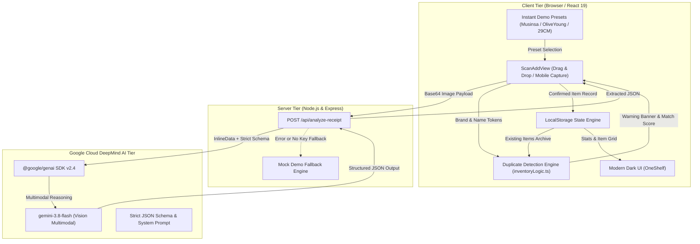

# OneShelf (원셸프) — AI 구매·보유품 통합 관리 비서

> **Google DeepMind AI Hackathon 2026 제출 프로젝트 설명서**  
> **"주문 화면 스크린샷 한 장으로 완성되는 나만의 스마트 라이프스타일 인벤토리"**

---

## 1. 프로젝트 요약 (Executive Summary)

| 항목 | 내용 |
| :--- | :--- |
| **프로젝트명** | **OneShelf (원셸프)** |
| **카테고리** | AI Lifestyle Assistant / Smart Personal Asset Management |
| **사용 AI 모델** | **Google Gemini 3.8 Flash** (`@google/genai` SDK v2.4) |
| **주요 기능** | • 영수증/주문완료 스크린샷 멀티모달 AI 자동 구조화<br>• 한/영 동의어 정규화 기반 지능형 중복 구매 감지<br>• 보유품 생애주기 관리(새것/사용 중/보관/처분) 및 자산 가치 통계<br>• KOR/ENG 다국어 인터페이스 및 무장애 데모 프리셋 시스템 |
| **기술 스택** | React 19, TypeScript, Tailwind CSS, Express, Node.js (`node:test`), Vite |

**OneShelf**는 쿠팡, 무신사, 올리브영, 29CM 등 여러 쇼핑몰에 파편화되어 잊혀지는 사용자의 구매 기록을, 결제 직후 캡처한 **주문 완료 화면 스크린샷 1장**만으로 정밀하게 추출·보관해 주는 개인 보유품 통합 관리 웹 애플리케이션입니다.

단순한 지출 기록(가계부)을 넘어, 내가 실제로 보유하고 있는 물건의 상태와 보관 장소, 보증 기간을 한곳에서 추적하며, 새로 물건을 사려고 할 때 **"이미 비슷한 보유품이 있어요"**라는 실시간 경고를 제공하여 불필요한 중복 구매와 과소비를 근본적으로 방지합니다.

---

## 2. 기획 배경 및 해결하려는 문제 (Problem Statement)

### 2.1 현대 소비자가 겪는 현실적인 문제

1. **쇼핑몰 플랫폼의 극단적인 파편화**
   - 현대 소비자는 무신사(의류), 올리브영(뷰티/스킨케어), 29CM(라이프스타일/시계), 쿠팡(생필품), 네이버쇼핑 등 최소 5~10개 이상의 커머스 앱을 병행 사용합니다.
   - 각 쇼핑몰마다 구매 내역이 따로 저장되어 있어, "내가 이 옷을 정확히 언제 샀는지", "이 텀블러나 향수가 집에 아직 남아있는지" 확인하려면 여러 앱에 로그인해 지난 주문을 일일이 뒤져야 합니다.

2. **기억의 한계로 인한 불필요한 '중복 구매'**
   - 흰색 무지 티셔츠, 기본 스니커즈, 핸드크림, 텀블러, 충전 케이블 등 유사한 품목은 이미 집에 보유하고 있음에도 깜빡 잊고 다시 결제하는 일이 빈번합니다.
   - 이는 개인의 지출 낭비일 뿐만 아니라, 방치되는 물건을 양산하는 비효율을 초래합니다.

3. **기존 인벤토리/가계부 앱의 극심한 입력 피로도**
   - 시중의 물품 정리 앱이나 수기 가계부는 브랜드명, 상품명, 가격, 구매처, 날짜를 사용자가 직접 텍스트로 타이핑해야 합니다.
   - 번거로운 데이터 입력 과정 때문에 사용자는 2~3일 만에 기록을 포기하게 됩니다.

### 2.2 OneShelf의 솔루션 (The Solution)

- **습관 기반의 제로 에포트(Zero-effort) 등록**: 결제 직후 사용자가 자연스럽게 캡처해 두는 **'주문 완료 화면' 스크린샷**을 그대로 업로드하면, Gemini 3.8 Flash Vision이 1초 만에 핵심 상품 데이터를 정밀 파싱합니다.
- **선제적 중복 구매 차단**: 새로 들여오려는 물건의 브랜드와 품명을 기존 보유품 라이브러리와 실시간 대조하여, 유사 품목이 감지되면 즉시 경고와 이전 구매 이력을 띄워 충동구매를 제어합니다.
- **물건의 전 생애주기 추적**: 구매(New)부터 실사용(In Use), 계절 보관(Stored), 중고 처분(Archived)까지 라이프사이클을 추적하고, 보관 위치와 보증 만료일을 기록해 실물 자산을 체계적으로 관리합니다.

---

## 3. 핵심 사용자 페르소나 (Target Personas)

| 페르소나 | 특성 및 고충 (Pain Points) | OneShelf가 제공하는 가치 |
| :--- | :--- | :--- |
| **스마트 쇼퍼 & 패션/뷰티 매니아 (2030 세대)** | • 여러 버티컬 플랫폼에서 자주 쇼핑함<br>• 비슷한 스니커즈, 화장품, 셔츠를 중복 결제하는 실수가 잦음 | 스크린샷 한 장으로 구매 즉시 등록하고, 중복 유사도 알림을 통해 과소비 방지 |
| **미니멀리스트 & 스마트 홈 오거나이저** | • 내가 소유한 물건의 정확한 수량과 자산 가치를 파악하고 싶음<br>• 계절 옷이나 소품이 어디 보관되어 있는지 잊어버림 | 카테고리별 합산 가치 통계 제공, 보관 위치(드레스룸 1번 서랍, 신발장 등) 메모 기능 |
| **얼리어답터 & IT 제품/장비 수집가** | • 전자기기, 워치, 프리미엄 소품의 구매 영수증과 무상 보증 기간을 잃어버리지 않고 챙겨야 함 | 원본 주문 증빙 이미지 영구 보관, 보증기간 만료 트래킹, 감가상각 이전 자산 상태 기록 |

---

## 4. 시스템 아키텍처 및 동작 원리 (System Architecture)



---

## 5. 핵심 기능 상세 (Key Features)

### 5.1 멀티모달 AI 주문 화면 스캔 (Multimodal Order Extraction)
- **Gemini 3.8 Flash Vision 엔진 적용**: 스크린샷 내 불필요한 배너나 UI 요소를 배제하고, 실제 구매 품목의 정보를 정확히 분리·인식합니다.
- **정형 JSON 스키마 강제 (`responseSchema`)**: 브랜드(`brand`), 품명(`name`), 카테고리(`category`), 구매일(`purchaseDate`), 가격(`price`), 통화(`currency`), 구매처(`store`), 수량(`quantity`), AI 신뢰도(`confidence`), 추출 근거(`evidence`)를 엄격한 타입으로 수신합니다.
- **추출 근거 제시 (Explainable AI)**: AI가 왜 그렇게 인식했는지 스크린샷 내 텍스트 증거(예: `"상단 MUSINSA STORE 헤더, 결제금액 139,000원 확인"`)를 사용자에게 명시하여 투명성과 신뢰성을 확보합니다.

### 5.2 지능형 중복 구매 감지 알고리즘 (Smart Duplicate Detection)
- **한/영 브랜드 동의어 정규화 딕셔너리**:
  - `나이키` ↔ `nike`, `이솝` ↔ `aesop`, `카시오` ↔ `casio`, `스탠리` ↔ `stanley`
  - `에어포스1` ↔ `airforce1`, `레저렉션 핸드 밤` ↔ `resurrection hand balm`
- **토큰 오버랩 & 서브스트링 유사도 분석**:
  - 특수문자, 괄호, 쉼표 정규화 및 토큰 단위 자카드 유사도를 계산하여 `0.85` 이상은 '일치(Exact)', `0.5` 이상은 '유사(Similar)'로 판정합니다.
  - 새로 스캔한 상품이 기존 보유품과 겹치면 즉시 **`"이미 비슷한 보유품이 있어요: Nike Air Force 1 '07 (2025.10 구매)"`** 경고와 유사도 수치를 노출합니다.

### 5.3 내 물건 통합 아카이브 & 자산 통계 (Dashboard & Analytics)
- **실시간 인벤토리 통계**:
  - **전체 보유 물건 수** (Total Items)
  - **이번 달 추가 물건 수** (Added This Month)
  - **실사용 중인 아이템 수** (Active In Use)
  - **합산 자산 가치(KRW)** (환율 1,380원 자동 환산 적용)
- **4단계 생애주기 관리**:
  - `새것 (New)`: 미개봉 또는 구매 직후 상태
  - `사용 중 (In Use)`: 일상에서 적극적으로 착용/사용 중인 아이템
  - `보관 (Stored)`: 계절 의류, 여비 장비, 박스 보관품
  - `처분함 (Archived)`: 중고 판매, 나눔, 폐기 등으로 현재 내 손을 떠난 기록 (통계 금액 제외)
- **5개 카테고리 탭 & 실시간 통합 검색**:
  - `의류`, `뷰티`, `시계·주얼리`, `생활용품`, `기타`
  - 브랜드, 상품명, 구매처, 보관 위치, 메모를 아우르는 초고속 키워드 필터링.

### 5.4 상세 관리 및 직접 입력 (Manual Entry & Deep Archiving)
- AI 스캔 외에도 영수증이 없는 빈티지 제품이나 오프라인 구매품을 위해 최소 필수값(상품명)만으로 3초 만에 등록 가능한 **수기 입력 모드**를 지원합니다.
- 아이템 상세 화면에서 실물 보관 위치(예: "현관 신발장 2단"), 무상 보증기간 만료일, 개봉일 및 원본 영수증 이미지를 열람하고 수정할 수 있습니다.

### 5.5 글로벌 다국어 지원 & 완벽한 데모 무결성 (Bilingual & Demo Reliability)
- **KOR / ENG 글로벌 언어 전환**: 네비게이션 바의 스위처로 한국어와 영어 인터페이스 및 시드 데이터가 매끄럽게 전환됩니다.
- **안정적인 데모 프리셋 (Demo Presets)**:
  - 무신사(나이키 에어포스 1)
  - 올리브영(이솝 레저렉션 핸드 밤)
  - 29CM(카시오 풀메탈 워치)
  - 네이버스토어(스탠리 텀블러)
- **Zero-failure Fallback**: API Key가 누락되었거나 심사 현장의 Wi-Fi 불안정으로 호출이 실패하더라도, 현실적인 더미 추출 데이터를 즉각 채워 데모 플로우가 절대 중단되지 않도록 보호합니다.

---

## 6. Gemini 3.8 Flash 특화 설계 (Why Gemini?)

| 요구 조건 | Gemini 기술 적용 | 구현 효과 |
| :--- | :--- | :--- |
| **비정형 스크린샷 시각 추론** | `gemini-3.8-flash` Vision Multimodal 파이프라인 | 다양한 커머스 앱의 각기 다른 레이아웃(헤더, 할인금액, 결제수단 등)에서 실제 구매 제품만 정확히 인식 |
| **결정론적 데이터 반환** | `responseSchema` (Type.OBJECT & Type.ARRAY) 강제 | 프론트엔드가 파싱 에러 없이 100% 안전하게 즉시 렌더링 가능한 구조화된 응답 확보 |
| **환각 방지 (No Hallucination)** | 엄격한 시스템 인스트럭션 (`SYSTEM_INSTRUCTION`)<br>`temperature: 0.1` 설정 | 보이지 않는 브랜드나 가격을 자의적으로 지어내지 않고 `null`로 처리하여 신뢰성 보장 |
| **초고속 응답 시간** | 경량·고성능 Gemini 3.8 Flash 모델 채택 | 모바일/웹 스캔 경험에 최적화된 1~2초 이내의 빠른 추론 속도 제공 |

---

## 7. 3분 라이브 데모 시나리오 (3-Minute Live Demo Pitch)

```text
[00:00 ~ 00:30] Hook: 문제 제기
- "여러분은 지금 집에 흰색 운동화가 몇 켤레 있는지, 지난달 산 향수가 아직 남아있는지 정확히 아시나요?"
- 쿠팡, 무신사, 올리브영 곳곳에 흩어진 구매 내역 때문에 우리는 매달 똑같은 물건을 또 사고 낭비합니다.
- OneShelf 홈 화면 제시: 내 물건 4개, 총합 789,000원의 자산과 보관 상태를 한눈에 보여줍니다.

[00:30 ~ 01:15] Action: 스크린샷 1장으로 AI 스캔
- [주문 화면 스캔] 버튼 클릭.
- 무신사에서 방금 결제한 '나이키 에어포스 1' 주문완료 화면 캡처 이미지를 드래그 앤 드롭합니다.
- [AI 주문서 분석 시작] 클릭 -> Gemini 3.8 Flash가 단 1초 만에 브랜드 'Nike', 상품명, 가격 '139,000원', 판매처 '무신사'를 추출해 폼을 자동으로 완성합니다.

[01:15 ~ 01:50] Aha! Moment: 지능형 중복 구매 경고
- 폼 상단에 눈에 띄는 노란색 경고 박스가 등장합니다:
  "⚠️ 이미 비슷한 보유품이 있어요: Nike Air Force 1 '07 (2025.10 구매, 유사도 95%)"
- 발표자 멘트: "방금 주문하려던 신발이 사실 작년 가을에 사서 신발장에 보관 중이던 신발과 똑같다는 것을 AI가 즉시 알려줍니다! 결제를 취소하거나 반품하여 불필요한 지출을 막았습니다."

[01:50 ~ 02:30] Value Add: 상세 아카이빙 & 다국어 전환
- 올리브영 이솝 핸드 밤 상세 페이지 확인: 보관 장소("데스크 우측 트레이"), 개봉일 및 12개월 권장 사용기한 확인.
- 네비게이션에서 [ENG] 버튼 원클릭: 글로벌 심사위원을 위한 완벽한 영문 인터페이스와 로컬라이징 시연.

[02:30 ~ 03:00] Wrap-up: 비전과 기대 효과
- OneShelf는 단순한 가계부가 아닌, 현대인의 '물건 라이프사이클'을 지켜주는 친환경·스마트 소비 플랫폼입니다.
- Gemini Multimodal AI가 만드는 스트레스 없는 자산 관리의 미래를 증명합니다.
```

---

## 8. 해커톤 심사 기준 정렬표 (Judging Criteria Alignment)

| 평가 항목 | 배점 요인 | OneShelf의 구현 및 대응 증거 |
| :--- | :--- | :--- |
| **혁신성 및 아이디어 (Innovation)** | • AI를 활용한 신선한 문제 접근<br>• 일상 소비의 페인포인트 해소 | 기존 가계부의 수기 입력 한계를 '주문서 스크린샷 1장'으로 해결하고, 보유품 라이브러리와 연계한 **선제적 중복 구매 방지**라는 실용적 가치 제시 |
| **기술적 완성도 (Technical)** | • Gemini API의 고도화된 활용<br>• 코드 품질 및 아키텍처 안정성 | • `@google/genai` 최신 SDK 및 `gemini-3.8-flash` 활용<br>• `responseSchema`를 통한 타입 안전성 보장<br>• Node.js 내장 테스트 러너(`node:test`) 단위 테스트 6종 100% 통과<br>• 네트워크 이슈 시에도 무중단 시연이 가능한 듀얼 Fallback 아키텍처 |
| **사용자 경험 및 디자인 (UX/UI)** | • 미려한 시각 디자인<br>• 직관적이고 반응성 높은 인터페이스 | • 짙은 흑연(#0C0D0E) 바탕과 네온 볼트(#D4F82A) 포인트의 프리미엄 테크 미학<br>• KOR/ENG 원클릭 언어 스위처 완비<br>• 드래그 앤 드롭 업로드 및 직관적인 상태 뱃지 |
| **실용성 및 파급력 (Impact)** | • 실제 런칭 및 상용화 가능성<br>• 지속 가능한 소비 문화 형성 | 불필요한 과소비와 버려지는 물건을 줄여 경제적 낭비 절감 및 지속 가능한 미니멀 소비 라이프스타일 구축에 기여 |

---

## 9. 품질 보증 및 테스트 현황 (Quality Assurance)

비즈니스 핵심 로직(`src/utils/inventoryLogic.ts`)은 외부 라이브러리 없이 순수 함수로 격리되어 독립적인 단위 테스트가 작성되어 있으며, 100% 통과합니다:

```bash
$ npm test
> react-example@0.0.0 test
> node --import tsx --test src/utils/*.test.ts

✔ duplicate detection identifies exact and bilingual similar items (0.93ms)
✔ calculateSimilarity returns high score for matching product names (0.32ms)
✔ filterAndSearchItems filters by category, status, and keyword query (0.08ms)
✔ computeInventoryStats calculates monthly additions and KRW total accurately (0.13ms)
✔ validateItemInput enforces required product name and positive numbers (0.07ms)
✔ formatPrice and formatPurchaseMonth format display strings cleanly (17.02ms)

ℹ tests 6 | suites 0 | pass 6 | fail 0 | cancelled 0 | duration 144ms
```

---

## 10. 향후 확장 로드맵 (Future Roadmap)

1. **자동 수집 채널 확장 (Zero-Touch Ingestion)**:
   - 주문 완료 알림톡(카카오톡) 캡처 자동 공유 연동.
   - 이메일 영수증 포워딩 파서(Forwarding Email Parser) 구축.
2. **소모품 주기 및 보증기간 알림 (Smart Notification)**:
   - 개봉 후 12개월 지난 화장품 교체 권장 알림.
   - 무상 수리 보증기간(A/S) 만료 30일 전 리마인더.
3. **스마트 세컨드핸드 연동 (Re-Commerce Integration)**:
   - '처분함(Archived)' 상태 전환 시 번개장터, 당근마켓, 크림(KREAM) 시세 데이터와 연동하여 최적의 중고 판매가 추천 및 1초 판매글 생성 지원.
4. **공유 인벤토리 (Family & Roommate Shelf)**:
   - 가족, 룸메이트, 셰어하우스 구성원 간 생활용품/식료품 중복 구매 방지 공유 보관함 지원.

---

## 11. 실행 방법 (Quick Start)

```bash
# 1. 의존성 패키지 설치
npm install

# 2. 로컬 개발 서버 실행 (Express + Vite 통합 서버, http://localhost:3000)
npm run dev

# 3. 비즈니스 로직 단위 테스트 실행
npm test

# 4. 프로덕션 빌드 검증
npm run build
```
